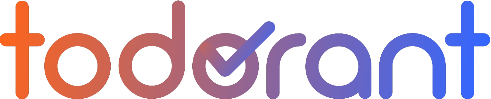
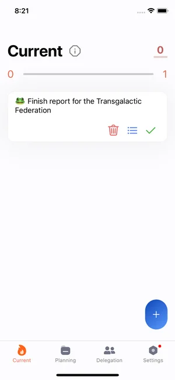
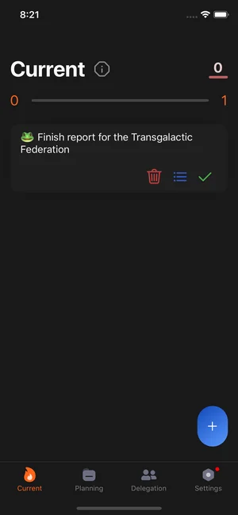

<div align="center">

<a href="https://todorant.com"></a>

### Productivity systems fail. Todorant works.

Todorant is an open-source todo app built on behavioral psychology to stop procrastination: it shows you one task at a time,<br>
puts the task you dread first (eat the frog) and makes you give every todo a date or a month.<br>
It's free, runs on the web, Android and iOS, and you can host your own server in a couple of minutes.

**[Open todorant.com](https://todorant.com)** · [iOS](https://apps.apple.com/app/todorant/id1482078243) · [Android](https://play.google.com/store/apps/details?id=com.todorant) · [Self-hosting](docs/self-hosting.md) · [Blog](https://blog.todorant.com)<br>
<sub>iOS 2.2.0 for iPhone and iPad (iOS 17 or later) · Android 2.2.1</sub>

<br>


&nbsp;&nbsp;&nbsp;


</div>

## Why Todorant

Most productivity apps are great at storing, organizing and automating endless lists of tasks, and that is exactly where they fail you: a list that keeps growing doesn't get anything done. Todorant cares about the one thing that matters, which is finishing what you planned.

It does that with four simple rules, backed by a carefully tuned set of limits and praise that makes the primitive part of your brain crave completed todos the way people crave sugar:

- **Focus on one task at a time.** The Current screen shows only the todo you should be doing right now.
- **Always add a date or a month to a task.** Every todo gets its place in time, so nothing lingers in a list forever.
- **Complete unpleasant tasks first.** Todos you dread are marked as frogs and come before everything else on their day.
- **Keep your inbox empty.** Overdue todos have to be planned again before you can get back to work.

Todorant grew out of more than twenty productivity books and methodologies. When they failed one by one, the parts that worked were combined and simplified into a single system that you can learn in a minute.

## What's inside

- **Realtime sync** between all your devices, with offline support and field-level conflict resolution, so changes made on two devices at once both survive.
- **End-to-end encryption** of your todos with a password of your choice.
- **Delegation**, to hand todos to friends and colleagues and accept the ones they hand to you.
- A **Telegram bot** that turns messages into todos, **hashtags and epics** to group related work, and **reports** of everything you've done.
- **More than twenty languages**, from German, French and Spanish to Japanese, Chinese, Arabic and Hindi, that follow your device language, and a dark mode on every platform.

## How it compares

Compared as of November 2026, from each app's own site:

- **Todoist** is a closed-source cloud service with a free plan and paid plans. It is built to hold and organize as many tasks as you like, with projects, labels, filters, priorities and recurring tasks, and it can't be self-hosted. Todorant deliberately does less: one current task, frogs first, a date or month on every todo, and no recurring tasks at all, because a repeating task that is never finished mostly causes anxiety.
- **Sunsama** is a closed-source daily planner, paid after a 14-day trial, that pulls tasks from your calendar and other tools and walks you through planning each day. Todorant also asks you to plan every morning and every month, but it has no calendar or third-party integrations apart from its own Telegram bot.
- **TickTick** is a closed-source task manager with calendar views, a habit tracker and a Pomodoro timer. Todorant has none of those, and is meant for people who want fewer choices rather than more tools.

Todorant is free with no ads and no subscriptions, it is open source under the MPL-2.0, and its server and web app run on your own hardware from two Docker images, with the Android and iOS apps pointed at that server.

## FAQ

**What's a todo app that stops me from procrastinating?** Todorant's Current screen shows only the one task you should do now. You can skip an ordinary task now and then, but never a frog, and a task you've had to plan again twice becomes a frog. Overdue todos have to be planned again before you can get back to work, so nothing silently piles up.

**Is Todorant built on behavioral psychology, like eating the frog?** Yes. Tasks you dread are marked as frogs and come before everything else on their day, and the app's limits and praise are tuned to make finishing todos feel rewarding. [How Todorant works](https://todorant.com/how-it-works) explains every rule.

**Can I self-host it with iOS and Android apps?** Yes. Start the server with the compose file below, then choose **Settings → Server** in the Android or iOS app. The [self-hosting guide](docs/self-hosting.md) covers HTTPS, backups and every setting.

**Is it free?** Yes, on todorant.com and on your own server alike.

## Host your own

The backend and the web app are published as Docker images for amd64 and arm64, so a server of your own takes one compose file and a secret:

```sh
mkdir todorant && cd todorant
curl -fsSLO https://raw.githubusercontent.com/backmeupplz/todorant/main/docker-compose.yml
curl -fsSL https://raw.githubusercontent.com/backmeupplz/todorant/main/.env.example -o .env
sed -i.bak "s/^JWT=.*/JWT=$(openssl rand -hex 32)/" .env && rm .env.bak
docker compose up -d
```

Open http://localhost:8080 and create an account with your email and a password. The Android and iOS apps connect to your server from **Settings → Server**. The [self-hosting guide](docs/self-hosting.md) walks through HTTPS, access from other devices, backups and every setting.

## Repository

| Folder | What lives there |
| --- | --- |
| [`backend`](backend) | The Koa and MongoDB API behind todorant.com: `/v2` REST with realtime WebSocket sync for the current apps, and the original API that older clients still use |
| [`web`](web) | The web app at [todorant.com](https://todorant.com), built with Preact, keeping a copy of your data in IndexedDB and syncing it live |
| [`android`](android) | The native Android app, written in Kotlin with Jetpack Compose |
| [`ios`](ios) | The native iPhone and iPad app, written in Swift with SwiftUI, sharing the Android app's translations |
| [`docs`](docs) | The self-hosting guide |

## Development

Every app talks to the backend over HTTP and a WebSocket, so you can work on any of them against todorant.com's backend or against one running on your machine.

**Backend** needs Node 16 and MongoDB:

```sh
cd backend
cp .env.sample .env    # at least MONGO and JWT
yarn install --ignore-engines
yarn develop           # the API on http://localhost:1337
```

**Web app** needs Node 22:

```sh
cd web
npm ci
npm run dev                                   # against backend.todorant.com
VITE_API=http://localhost:1337 npm run dev    # against your local backend
```

**Android app** needs JDK 17 and the Android SDK:

```sh
cd android
./gradlew :app:installDebug                              # against backend.todorant.com
./gradlew :app:installDebug -Papi=http://10.0.2.2:1337   # the emulator's view of your machine
```

**iOS app** needs Xcode 27:

```sh
cd ios
./build.sh                                # simulator build; run the Todorant scheme from Xcode
./build.sh archive                        # App Store archive (automatic signing)
xcodebuild -scheme Todorant -destination 'platform=iOS Simulator,name=iPhone 17' test -only-testing:Tests
```

Run it with the launch argument `-API http://localhost:1337` to use your local backend (Edit Scheme → Arguments).

Pushes to `main` deploy on their own once the checks pass: the backend to backend.todorant.com, the web app to GitHub Pages, and fresh Docker images to the GitHub Container Registry. Android builds are attached to [releases](https://github.com/backmeupplz/todorant/releases). To release, bump `versionName`/`versionCode` in `android/app/build.gradle.kts`, add `fastlane/metadata/android/en-US/changelogs/<versionCode>.txt` and publish the release on git.borodutch.com: `tea release create --repo backmeupplz/todorant --tag vX.Y.Z --target main --title "Todorant X.Y.Z" --note-file fastlane/metadata/android/en-US/changelogs/<versionCode>.txt`. `.forgejo/workflows/release.yml` then ships Google Play, the App Store and the F-Droid merge request, and attaches the APKs to that release and to the same release on GitHub, which it creates there since releases don't mirror. The iOS app ships only through the [App Store](https://apps.apple.com/app/todorant/id1482078243), since an App Store build can't be installed any other way.

## License

Todorant is open source under the [Mozilla Public License 2.0](LICENSE). Questions, ideas and bug reports are welcome in [issues](https://github.com/backmeupplz/todorant/issues) or at n@borodutch.com.
