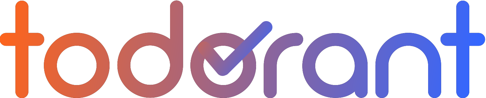
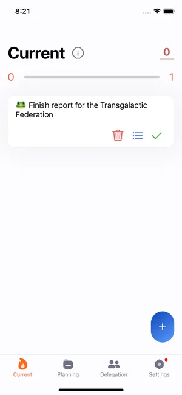
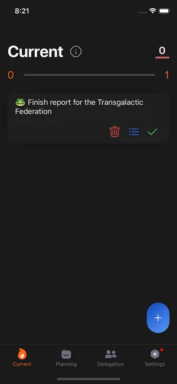

<div align="center">

<a href="https://todorant.com"></a>

### Productivity systems fail. Todorant works.

Todorant is a todo manager that uses behavioral psychology to help you get things done.<br>
It runs on the web, Android and iOS, and you can host your own server in a couple of minutes.

**[Open todorant.com](https://todorant.com)** · [iOS](https://apps.apple.com/app/todorant/id1482078243) · [Android](https://github.com/backmeupplz/todorant/releases?q=android&expanded=true) · [Self-hosting](docs/self-hosting.md)<br>
<sub>iOS 2.2.0 for iPhone and iPad (iOS 17 or later) · Android 2.2.0</sub>

<br>


&nbsp;&nbsp;&nbsp;


</div>

## Why Todorant

Most productivity apps are great at storing, organizing and automating endless lists of tasks, and that is exactly where they fail you: a list that keeps growing doesn't get anything done. Todorant cares about the one thing that matters, which is finishing what you planned.

It does that with four simple rules, backed by a carefully tuned set of limits and praise that makes the primitive part of your brain crave completed todos the way people crave sugar:

- **Focus on one task at a time.** The Current screen shows only the todo you should be doing right now.
- **Always add a date or a month to a task.** Every todo gets its place in time, so nothing lingers in a list forever.
- **Complete unpleasant tasks first.** Todos you dread are marked as frogs and come before everything else on their day.
- **Keep your inbox empty.** Overdue todos have to be planned again before you can get back to work.

Todorant grew out of more than twenty productivity books and methodologies. When they failed one by one, the parts that worked were combined and simplified into a single system that you can learn in a minute.

## What's inside

- **Realtime sync** between all your devices, with offline support and field-level conflict resolution, so changes made on two devices at once both survive.
- **End-to-end encryption** of your todos with a password of your choice.
- **Delegation**, to hand todos to friends and colleagues and accept the ones they hand to you.
- **Google Calendar sync**, a **Telegram bot** that turns messages into todos, **hashtags and epics** to group related work, and **reports** of everything you've done.
- **Six languages** (English, Spanish, Italian, Portuguese, Russian and Ukrainian) and a dark mode on every platform.

## Host your own

The backend and the web app are published as Docker images for amd64 and arm64, so a server of your own takes one compose file and a secret:

```sh
mkdir todorant && cd todorant
curl -fsSLO https://raw.githubusercontent.com/backmeupplz/todorant/main/docker-compose.yml
curl -fsSL https://raw.githubusercontent.com/backmeupplz/todorant/main/.env.example -o .env
sed -i.bak "s/^JWT=.*/JWT=$(openssl rand -hex 32)/" .env && rm .env.bak
docker compose up -d
```

Open http://localhost:8080 and create an account with your email and a password. The Android and iOS apps connect to your server from **Settings → Server**. The [self-hosting guide](docs/self-hosting.md) walks through HTTPS, access from other devices, backups and every setting.

## Repository

| Folder | What lives there |
| --- | --- |
| [`backend`](backend) | The Koa and MongoDB API behind todorant.com: `/v2` REST with realtime WebSocket sync for the current apps, and the original API that older clients still use |
| [`web`](web) | The web app at [todorant.com](https://todorant.com), built with Preact, keeping a copy of your data in IndexedDB and syncing it live |
| [`android`](android) | The native Android app, written in Kotlin with Jetpack Compose |
| [`ios`](ios) | The native iPhone and iPad app, written in Swift with SwiftUI, sharing the Android app's translations |
| [`docs`](docs) | The self-hosting guide |

## Development

Every app talks to the backend over HTTP and a WebSocket, so you can work on any of them against todorant.com's backend or against one running on your machine.

**Backend** needs Node 16 and MongoDB:

```sh
cd backend
cp .env.sample .env    # at least MONGO and JWT
yarn install --ignore-engines
yarn develop           # the API on http://localhost:1337
```

**Web app** needs Node 22:

```sh
cd web
npm ci
npm run dev                                   # against backend.todorant.com
VITE_API=http://localhost:1337 npm run dev    # against your local backend
```

**Android app** needs JDK 17 and the Android SDK:

```sh
cd android
./gradlew :app:installDebug                              # against backend.todorant.com
./gradlew :app:installDebug -Papi=http://10.0.2.2:1337   # the emulator's view of your machine
```

**iOS app** needs Xcode 27:

```sh
cd ios
./build.sh                                # simulator build; run the Todorant scheme from Xcode
./build.sh archive                        # App Store archive (automatic signing)
xcodebuild -scheme Todorant -destination 'platform=iOS Simulator,name=iPhone 17' test -only-testing:Tests
```

Run it with the launch argument `-API http://localhost:1337` to use your local backend (Edit Scheme → Arguments).

Pushes to `main` deploy on their own once the checks pass: the backend to backend.todorant.com, the web app to GitHub Pages, and fresh Docker images to the GitHub Container Registry. Android builds are attached to [releases](https://github.com/backmeupplz/todorant/releases). The iOS app ships only through the [App Store](https://apps.apple.com/app/todorant/id1482078243), since an App Store build can't be installed any other way.

## License

Todorant is open source under the [Mozilla Public License 2.0](LICENSE). Questions, ideas and bug reports are welcome in [issues](https://github.com/backmeupplz/todorant/issues) or at n@borodutch.com.
